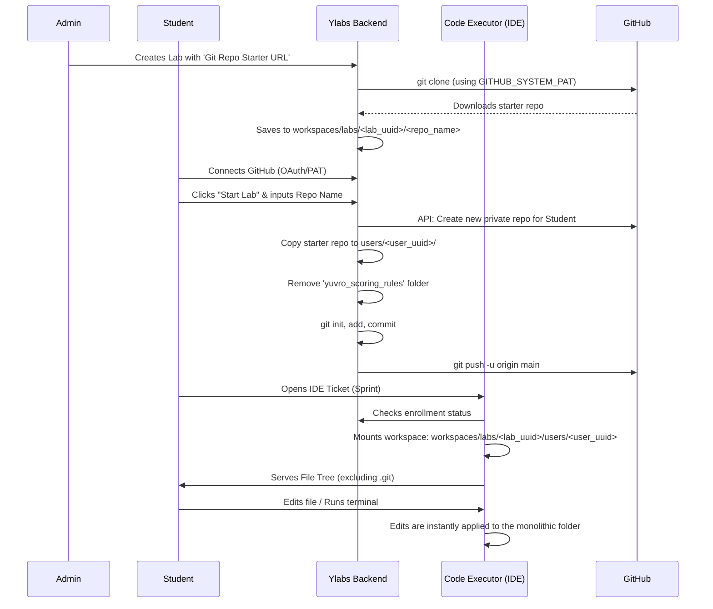

# Yuvro Labs - Workspace & IDE Flow

This document explains the end-to-end flow for provisioning labs, creating student workspaces, and managing GitHub repositories in Yuvro Labs.

## 📁 Folder Structure

All labs and workspaces are managed in a central `workspaces/` directory on the host machine.

```text
yuvro/
├── workspaces/
│   └── labs/
│       └── <lab_uuid>/                       <-- Created when Admin adds a Lab
│           ├── <starter_repo_name>/          <-- Cloned from the Admin-provided URL
│           └── users/
│               └── <user_uuid>/              <-- Created when a Student clicks "Start Lab"
│                   ├── src/                  
│                   ├── index.html            <-- The student's monolithic workspace
│                   └── .git/                 <-- Student's personal git tracking
```

### Key Differences:
- **Starter Repo (`labs/<lab_uuid>/<repo_name>`)**: This is the pristine codebase downloaded when the admin saves the lab. It contains all files (including `yuvro_scoring_rules`).
- **Student Workspace (`labs/<lab_uuid>/users/<user_uuid>`)**: This is where the code executor runs the IDE, terminal, and file tree APIs. It is a copy of the starter repo **excluding** `yuvro_scoring_rules` and the original `.git` history.

---

## 🔄 End-to-End Workflow



---

## 🛠️ Enrollment & IDE Mechanics

### 1. Enrollment Interception
If a student attempts to navigate directly to a ticket's IDE (`/student/lab/$slug/ticket/$ticketId`) without first enrolling in the lab, the frontend intercepts the action.
- The user is presented with a **"Start Lab" modal** prompting them for a repository name.
- Only after this background task successfully provisions the GitHub repo and local workspace will the user be allowed to enter the IDE.

### 2. Monolithic IDE Architecture
- **Single Workspace**: All tickets (sprints) within a single lab share the exact same directory: `workspaces/labs/<lab_uuid>/users/<user_uuid>`. 
- **File System**: The `ycode-executor-api` backend intercepts REST (`/workspace/file`) and WebSocket (`/workspace/terminal`) calls, pointing them to this monolithic path.
- **Git State**: If a user runs git commands inside the in-browser terminal, those changes apply directly to their connected GitHub repository because the backend runs `git remote add origin` with their personal token injected.

---

## 🔐 Environment Variables

To make this flow work seamlessly, you must ensure the following environment variables are configured.

### `ylabs-backend-api/.env.local-secrets`
| Variable | Description |
|---|---|
| `GITHUB_SYSTEM_PAT` | A GitHub Personal Access Token (PAT) belonging to the Admin or System account. It must have at least `repo` read access so the backend can clone private starter repositories when the Admin creates a lab. |

---

## 🔧 Managing Options & Edge Cases

- **Customizing Starter Repositories**: The system supports any public or private git URL (HTTPS). If the URL is private, it will dynamically inject `GITHUB_SYSTEM_PAT` into the connection string via `https://oauth2:<token>@github.com/...`.
- **Modifying IDE visibility**: The `.git` directory is explicitly hidden from the frontend IDE file tree to prevent students from breaking their connection to GitHub, though they can still interact with it via the terminal.
- **Troubleshooting Missing Workspaces**: If a student's code is not syncing, ensure that their `/users/<user_uuid>` directory was successfully created. You can trigger a re-sync by deleting their enrollment in the Django admin panel and having them click "Start Lab" again.
