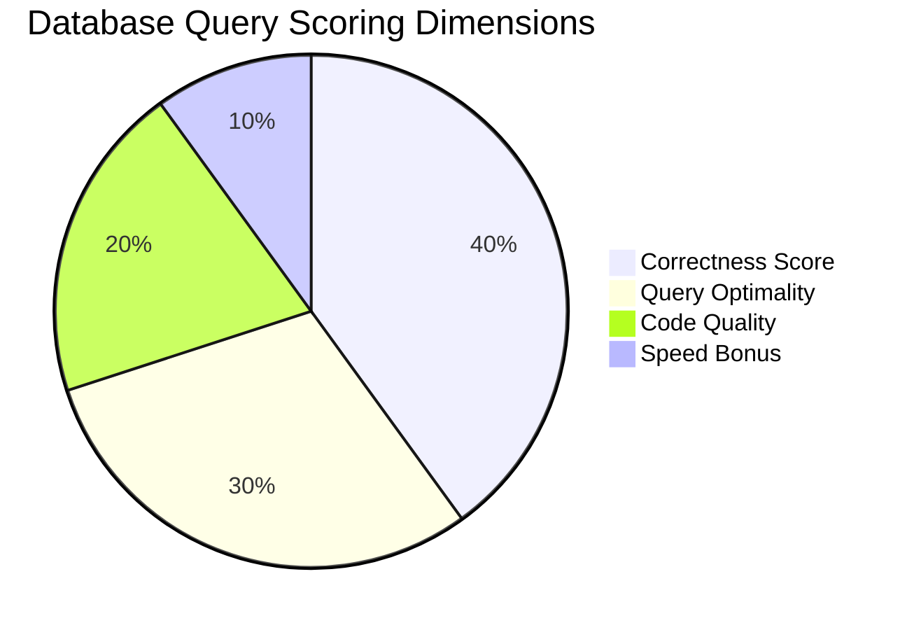

# 🚀 Yuvro Labs: Database Sprint & Lab Planning Dashboard (MySQL & PostgreSQL)

Welcome to your central planning dashboard for **MySQL and PostgreSQL Labs**. This document outlines your database sprints, grading rubrics, automated evaluation criteria, and reference cheatsheets.

---

## 📋 Notion Copy-Paste Instructions
To import this planning page into Notion:
1. Click the raw contents of this file and copy it (`Ctrl + A`, then `Ctrl + C`).
2. Open your Notion workspace and create a new page.
3. Paste the contents directly (`Ctrl + V`). Notion will automatically parse headers, tables, code blocks, and check-boxes!

---

## ⚙️ Automated Database Evaluation System

Every SQL query submitted in the lab editor is executed against sandboxed database fixtures (MySQL 8.0 & PostgreSQL 16) and graded by our automated evaluation backend.

### 🧪 Verifier Functions
The grading runner uses three verification modes to grade database code:

| Method | Check Scope | Verifier Commands Used |
| :--- | :--- | :--- |
| **Method 1: Query Challenge Runner** | Output correctness, rows count, sorting offsets | `compare_result_sets()`, `check_row_count()`, `check_sort_order()`, `check_projected_fields()` |
| **Method 2: Index & Execution Plan Checker** | Query performance, index hits | `check_explain_plan()`, `verify_index_usage()`, `check_no_sequential_scan()`, `measure_execution_ms()` |
| **Method 3: Constraint & Schema Validator** | DDL constraints, normalization integrity | `validate_ddl_structure()`, `check_constraint_violation()`, `verify_acid_properties()` |

---

## 🪙 100-Point Database Grading Rubric

Tasks are scored out of a maximum of **100 points** across four key dimensions:



### 🔴 [A] Correctness Score (40 pts)
* **40 pts**: Output matches expected results exactly (rows, column structure, values).
* **30 pts**: Output data matches, but minor field ordering or sorting issues.
* **20 pts**: Partially correct (some rows match, but others are missing).
* **10 pts**: Wrong results but displays a logical database structure.
* **0 pts**: Syntax errors, query timeouts, or target tables missing.

### 🟡 [B] Query Optimality (30 pts)
* **30 pts**: Scan type is `Index Scan / IXSCAN`. Minimal rows read, execution time `< 10ms`.
* **20 pts**: Index hit is successful, but query contains redundant joins or subqueries.
* **10 pts**: `Sequential Scan / COLLSCAN` is used, though outputs are correct.
* **0 pts**: Heavy brute force, massive cross-joins, or complete lack of optimization.

### 🟢 [C] Code Quality (20 pts)
* **20 pts**: Idiomatic syntax, uppercase SQL commands (`SELECT`, `JOIN`), appropriate aliases, and readable CTEs.
* **10 pts**: Works, but uses outdated/non-ANSI implicit joins (`FROM tableA, tableB`).
* **0 pts**: Unstructured, duplicate statements, or copy-pasted comments.

### 🔵 [D] Speed Bonus (10 pts)
* **10 pts**: Challenge solved within the estimated baseline time.
* **0 pts**: Target deadline exceeded.

---

## 🛠️ Track 1: MySQL Lab (YuvroCart E-Commerce)
*Goal: Manage, aggregate, and normalize database records for a full-stack electronics store.*

### 🏁 Sprint 1: Querying & Filtering (2 Weeks)
- [ ] **SQL-101**: **Customer Signups & Filtering**
  * *Objective*: Query customers in USA signed up in 2024. *(Easy - 10 pts)*
  * *Hint*: Combine `WHERE country = 'USA' AND status = 'active'` with date range filtering.
  * *Solution*:
    ```sql
    SELECT id, name, email, country, signed_up_at
    FROM customers
    WHERE country = 'USA' AND status = 'active' AND signed_up_at >= '2024-01-01'
    ORDER BY signed_up_at DESC;
    ```
- [ ] **SQL-102**: **Monthly Sales Revenue**
  * *Objective*: Calculate monthly store revenue using SUM/COUNT, GROUP BY, and HAVING. *(Medium - 20 pts)*
  * *Hint*: Group by `TO_CHAR(created_at, 'YYYY-MM')` and use HAVING to filter monthly totals.
  * *Solution*:
    ```sql
    SELECT TO_CHAR(created_at, 'YYYY-MM') AS order_month, SUM(total_amount) AS total_sales
    FROM orders
    WHERE status = 'completed'
    GROUP BY TO_CHAR(created_at, 'YYYY-MM')
    HAVING SUM(total_amount) > 500;
    ```

### 🏁 Sprint 2: Table Relational Joins (2 Weeks)
- [ ] **SQL-103**: **Churned Customers (LEFT JOIN)**
  * *Objective*: Retrieve customers who registered but have never placed an order. *(Medium - 20 pts)*
  * *Hint*: LEFT JOIN customers to orders and filter where order ID IS NULL.
  * *Solution*:
    ```sql
    SELECT c.id AS customer_id, c.name, c.email
    FROM customers c
    LEFT JOIN orders o ON o.customer_id = c.id
    WHERE o.id IS NULL;
    ```
- [ ] **SQL-104**: **Category Sales Performance (Multi JOIN)**
  * *Objective*: Evaluate items sold and revenues generated per product category. *(Medium - 20 pts)*
  * *Hint*: Join `order_items` -> `products` to sum quantities and multiply units by unit prices.
  * *Solution*:
    ```sql
    SELECT p.category, SUM(oi.quantity) AS total_quantity, SUM(oi.quantity * oi.price_per_unit) AS total_revenue
    FROM order_items oi
    JOIN products p ON oi.product_id = p.id
    GROUP BY p.category;
    ```

### 🏁 Sprint 3: Window Functions & Optimizations (2 Weeks)
- [ ] **SQL-201**: **Best-Selling Products (RANK)**
  * *Objective*: Find the top 3 best-selling items in each category. *(Hard - 30 pts)*
  * *Hint*: Apply `DENSE_RANK() OVER (PARTITION BY category ORDER BY quantity DESC)`.
- [ ] **SQL-202**: **Month-over-Month Sales Growth (LAG)**
  * *Objective*: Compute MoM sales percentages compared to the previous month. *(Hard - 30 pts)*
  * *Hint*: Use `LAG(SUM(total_amount))` to offsets monthly sales.
- [ ] **SQL-301**: **Tuning Slow Joins (Explain Plan)**
  * *Objective*: Optimize a slow date range scan by writing a composite index. *(Hard - 30 pts)*
  * *Hint*: `CREATE INDEX idx_orders_date ON orders(created_at, status)`.

---

## 🛠️ Track 2: PostgreSQL Lab (ApexBank Ledger)
*Goal: Build scalable, transaction-safe schemas and queries for a digital bank.*

### 🏁 Sprint 1: Checking Ledgers & Daily Volumes (2 Weeks)
- [ ] **PG-101**: **High-Balance Banking Accounts**
  * *Objective*: Query checking accounts with active balances over $5,000. *(Easy - 10 pts)*
  * *Solution*:
    ```sql
    SELECT customer_name, account_type, balance, status
    FROM accounts
    WHERE account_type = 'checking' AND status = 'active' AND balance > 5000.00;
    ```
- [ ] **PG-102**: **Daily Transfer Volumes**
  * *Objective*: Calculate daily volume aggregates for completed deposits and withdrawals. *(Medium - 20 pts)*
  * *Solution*:
    ```sql
    SELECT type, DATE(created_at) AS tx_date, SUM(ABS(amount)) AS total_volume
    FROM transactions
    WHERE status = 'completed'
    GROUP BY type, DATE(created_at);
    ```

### 🏁 Sprint 2: Auditing & Recursive CTEs (2 Weeks)
- [ ] **PG-103**: **Dormant Account Audits**
  * *Objective*: Find customers with no active bank accounts. *(Medium - 20 pts)*
  * *Solution*:
    ```sql
    SELECT c.id, c.name FROM customers c
    LEFT JOIN accounts a ON a.customer_id = c.id
    WHERE a.id IS NULL;
    ```
- [ ] **PG-104**: **Recursive Referral Trees**
  * *Objective*: Trace customer referrals recursively starting from Customer 1. *(Hard - 30 pts)*
  * *Hint*: Use `WITH RECURSIVE referral_tree AS (...)`.
  * *Solution*:
    ```sql
    WITH RECURSIVE referral_tree AS (
      SELECT referred_id, referrer_id, 1 AS depth FROM referrals WHERE referrer_id = 1
      UNION ALL
      SELECT r.referred_id, r.referrer_id, rt.depth + 1
      FROM referrals r JOIN referral_tree rt ON r.referrer_id = rt.referred_id
    )
    SELECT rt.referred_id AS customer_id, c.name, rt.depth
    FROM referral_tree rt JOIN customers c ON rt.referred_id = c.id;
    ```

### 🏁 Sprint 3: JSONB Payloads & Window Ledgers (2 Weeks)
- [ ] **PG-105**: **JSONB Audit Logs Querying**
  * *Objective*: Query unstructured logs payload columns to find security audits. *(Medium - 20 pts)*
  * *Hint*: Use the JSONB containment operator `@>` to filter logs matching `{"status": "flagged"}`.
  * *Solution*:
    ```sql
    SELECT id, payload->>'user' AS user_involved
    FROM audit_logs
    WHERE payload @> '{"status": "flagged"}';
    ```
- [ ] **PG-106**: **Running Passbook Balances (Windows)**
  * *Objective*: Calculate cumulative transaction ledger values for Account 1. *(Hard - 30 pts)*
  * *Solution*:
    ```sql
    SELECT id, amount, SUM(amount) OVER (ORDER BY created_at) AS running_balance
    FROM transactions
    WHERE account_id = 1;
    ```
- [ ] **PG-107**: **EXPLAIN ANALYZE for Financial Indexes**
  * *Objective*: Tune dates ranges indexing to eliminate sequential table scans. *(Hard - 30 pts)*
  * *Solution*:
    ```sql
    CREATE INDEX idx_tx_account_date ON transactions(account_id, created_at);
    ```
