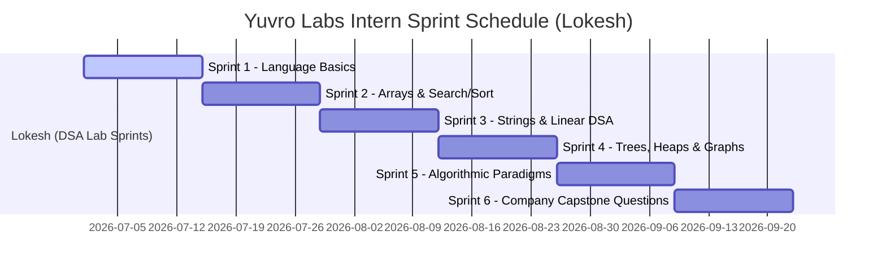

# 🚀 Yuvro Labs: Sprint & Lab Planning Dashboard (Lokesh)

Welcome to your central planning dashboard for **Yuvro Labs**. This document outlines your sprint structure, specific deliverables, and tasks for your programming lab.

Instead of writing code across multiple languages, you will select **one primary programming language** (C, C++, Python, OR Java) to focus on. Your points system is based on **Advanced LeetCode-style metrics**—rewarding problem difficulty, runtime speed, memory footprint, daily challenges, active streaks, peer collaboration, and mock contests.

---

## 📋 Notion Copy-Paste Instructions
To import this planning page into Notion:
1. Click the raw contents of this file and copy it (`Ctrl + A`, then `Ctrl + C`).
2. Open your Notion workspace and create a new page.
3. Paste the contents directly (`Ctrl + V`). Notion will automatically parse the headers, lists, tables, code blocks, and check-boxes!

---

## 🎨 Advanced Developer Gamification System

This points system rewards code efficiency, memory optimization, peer reviews, consistency, and competitive solving.

### 🪙 Earning Rubric

| Category | Performance Metric / Trigger | Points Awarded |
| :--- | :--- | :--- |
| 🟢 **Easy Solve** | Successfully solve an **Easy** difficulty problem | **10 pts** (Base) |
| 🟡 **Medium Solve**| Successfully solve a **Medium** difficulty problem | **20 pts** (Base) |
| 🔴 **Hard Solve** | Successfully solve a **Hard** difficulty problem | **30 pts** (Base) |
| 🥇 **Gold Speed** | Your solution runtime **beats >90%** of submissions | **+15 pts** (Bonus) |
| 🥈 **Silver Speed** | Your solution runtime **beats >70%** of submissions | **+10 pts** (Bonus) |
| 🥉 **Bronze Speed** | Your solution runtime **beats >50%** of submissions | **+5 pts** (Bonus) |
| 🍃 **Green Memory** | Your solution space footprint **beats >90%** of submissions | **+10 pts** (Bonus) |
| 💧 **Blue Memory** | Your solution space footprint **beats >70%** of submissions | **+5 pts** (Bonus) |
| 📅 **POTD Solve** | Solve the selected **Problem of the Day** on the platform | **+20 pts** (Bonus) |
| 👥 **Peer Review** | Help a peer debug or review code on local git / GitHub | **+10 pts** (Cap: Max 30 pts/week) |

> [!TIP]
> **🚀 Fail-Safe Performance Benchmarking Policy (Low-Submission Fallbacks)**
> 
> If a coding problem is new or has fewer than **50 total student submissions** (making percentile comparisons unstable), the platform automatically falls back to one of the following baseline rules to award speed and memory bonuses:
> 
> 1. **Pre-loaded Instructor Baselines**: The system pre-loads three reference solutions for every problem (Optimal, Average, and Brute-Force) coded by platform engineers. Your solution's execution is compared directly against these:
>    - **Gold / Green**: Matches or beats the *Optimal* instructor solution (e.g., $O(N)$ hash-map approach).
>    - **Silver / Blue**: Matches or beats the *Average* instructor solution (e.g., $O(N \log N)$ sort approach).
>    - **Bronze**: Matches or beats the *Brute-Force* instructor solution (e.g., $O(N^2)$ nested-loop approach).
> 2. **Predefined Threshold Limits (Static Time Targets)**: Execution runtimes are compared directly against static thresholds in milliseconds set specifically for each problem:
>    - **Gold**: Runtime $\le 100\text{ ms}$ | **Silver**: Runtime $\le 300\text{ ms}$ | **Bronze**: Runtime $\le 600\text{ ms}$ (example limits).
> 3. **Algorithmic Big-O Class Grading**: Your code is parsed for complexity:
>    - Linear/Logarithmic time complexity ($O(N)$, $O(\log N)$) $\rightarrow$ **Gold Speed / Green Memory**.
>    - Linearithmic time complexity ($O(N \log N)$) $\rightarrow$ **Silver Speed / Blue Memory**.
>    - Quadratic/Exponential time complexity ($O(N^2)$ or worse) $\rightarrow$ **Base Points Only**.

---

### 🔥 Active Streak Multipliers
Solve at least **one problem daily** to maintain your streak and multiply all your base and performance points:

*   🔥 **3-Day Active Streak**: **1.1x Points** multiplier on all solves
*   🔥 **7-Day Active Streak**: **1.2x Points** multiplier on all solves
*   🔥 **14-Day Active Streak**: **1.3x Points** multiplier on all solves
*   🔥 **30-Day+ Active Streak**: **1.5x Points** multiplier on all solves

---

### 🛡️ Streak Freeze Shop
*   🛡️ **Streak Freeze (Shield)**: Spend **150 acquired points** from your overall review log balance to purchase a Streak Shield. If you miss a day due to exams, sickness, or travel, your active streak is preserved. *(Limit: 1 shield purchase per sprint)*

---

### 📈 Developer Rank Tiers
Your rank increases as you accumulate points from your lab submissions and achievements:

| Rank Level | Title | Points Required | Criteria & Description |
| :--- | :--- | :--- | :--- |
| **Level 1** | 👶 **Syntax Recruit** | 0 pts | Getting comfortable with loops, basic compiler setups, and variables. |
| **Level 2** | 💻 **Logic Engineer** | 200 pts | Master arrays, basic matrix operations, linear searches, and simple sorting. |
| **Level 3** | 🔗 **Structure Weaver** | 500 pts | Implement dynamic pointer structures (Linked Lists, Stacks, Queues). |
| **Level 4** | 🌳 **Algorithmic Explorer**| 900 pts | Implement non-linear structures like Binary Search Trees, Heaps, and Graphs. |
| **Level 5** | ⚡ **Efficiency Architect**| 1,500 pts | Optimize programs using sliding windows, two pointers, and dynamic programming. |
| **Level 6** | 👑 **Polyglot Master** | 2,200+ pts | Successfully solve all Frequently Asked Company Questions with optimized execution. |

---

### 🎖️ Developer Milestone & Skill Badges

Unlock these custom badges to claim massive point bonuses:

#### 📅 Annual Consistency Badges
*   📅 **50 Days Active in 2026**: Solve at least 1 problem for 50 days in 2026 $\rightarrow$ **+100 pts**
*   📅 **100 Days Active in 2026**: Solve at least 1 problem for 100 days in 2026 $\rightarrow$ **+250 pts**

#### 🏆 Volume Milestone Badges
*   🏆 **50 Problems Solved**: Successfully compile and pass 50 distinct problems $\rightarrow$ **+100 pts**
*   🏆 **100 Problems Solved**: Successfully compile and pass 100 distinct problems $\rightarrow$ **+200 pts**

#### 🚀 Skill Tree Badges
*   🌀 **Recursion Wizard**: Solve 5 recursive problems in a row without stack overflow $\rightarrow$ **+30 pts**
*   👈👉 **Two-Pointer Tactician**: Solve all Two-Pointer tasks with optimal index tracking $\rightarrow$ **+40 pts**
*   🧬 **Pointer General**: Write 5 memory-leak-free dynamic allocation programs in C/C++ $\rightarrow$ **+50 pts**
*   🥇 **Speed Demon**: Achieve a 99% runtime beat score on any problem $\rightarrow$ **+50 pts**
*   🏆 **Sprint Finisher**: Complete all checklist programs in a single sprint $\rightarrow$ **+100 pts**

#### 🏁 Weekly Contests
*   🏆 **Contest Participant**: Participate in a weekly mock coding contest $\rightarrow$ **+15 pts**
*   🚀 **Contest Champion**: Solve 3 out of 4 contest questions within the time limit $\rightarrow$ **+50 pts**

---
---

## 🛠️ Track: Lokesh (C, C++, Python, OR Java Lab)
*Goal: Select one primary programming language (C, C++, Python, OR Java) and build robust, high-performance implementations. Sprints are organized by topics directly aligned with `ycode` course fixtures.*

> [!IMPORTANT]
> **Chosen Language Selection**: Select your language before starting:
> `[ ] C`  |  `[ ] C++`  |  `[ ] Python`  |  `[ ] Java`

### 🏁 Sprint 1: Programming Language Fundamentals (2 Weeks)
*   **Learning Objectives**: Learn basic syntax, data types, variable declarations, loops, condition blocks, operations, and function declarations.
*   **Sprint Points Goal**: **100 pts (Base) / 150 pts (Target with Bonuses)**

#### 📝 Program Checklist:
- [ ] **Program 1**: **Prime Number Checker**: Input an integer $N$ and determine if it is prime. Output true or false. *(Easy - 10 pts)*
- [ ] **Program 2**: **Factorial Calculation**: Compute the factorial of a number $N$ recursively and iteratively. *(Easy - 10 pts)*
- [ ] **Program 3**: **Fibonacci Generator**: Print the first $N$ numbers in the Fibonacci sequence. *(Easy - 10 pts)*
- [ ] **Program 4**: **Basic Calculator**: Accept two numbers and a character operator (`+`, `-`, `*`, `/`) and print the result. *(Easy - 10 pts)*
- [ ] **Program 5**: **Count Even and Odd Elements**: Loop through an array of size $N$ and count even/odd elements. *(Easy - 10 pts)*
- [ ] **Program 6**: **Toggle Character Casing**: Iterate through a string and invert lowercase letters to uppercase and vice versa. *(Easy - 10 pts)*
- [ ] **Program 7**: **Reverse Words in a Sentence**: Input a sentence string, reverse the order of the words, and output the result. *(Medium - 20 pts)*
- [ ] **Program 8**: **Remove Duplicate Elements**: Input an unsorted array, remove duplicates in-place, and return the size of the unique array. *(Medium - 20 pts)*

---

### 🏁 Sprint 2: Arrays, Searching & Sorting (2 Weeks)
*   **Learning Objectives**: Array representations in memory, contiguous locations, linear search, binary search on sorted segments, and basic sorting algorithms (bubble, selection, insertion).
*   **Sprint Points Goal**: **110 pts (Base) / 160 pts (Target with Bonuses)**

#### 📝 Program Checklist:
- [ ] **Program 1**: **Find Min/Max Element**: Scan a linear array in $O(N)$ and output the smallest and largest values. *(Easy - 10 pts)*
- [ ] **Program 2**: **Check if Array is Sorted**: Scan an array and return true if sorted in ascending order, else false. *(Easy - 10 pts)*
- [ ] **Program 3**: **Frequency of Elements**: Count and print the occurrence frequency of each element in an array. *(Easy - 10 pts)*
- [ ] **Program 4**: **Move Zeros to the End**: Move all zero elements to the end of the array without altering the relative order of non-zero elements. *(Medium - 20 pts)*
- [ ] **Program 5**: **Linear Search Implementation**: Search for a target value $T$ in an unsorted array, return index or -1. *(Easy - 10 pts)*
- [ ] **Program 6**: **Binary Search Implementation**: Implement binary search recursively or iteratively on a sorted array of size $N$. *(Easy - 10 pts)*
- [ ] **Program 7**: **Rotated Sorted Array Search**: Find index of target in an array that has been rotated by unknown pivots. *(Medium - 20 pts)*
- [ ] **Program 8**: **Sort an Array of 0s, 1s, and 2s**: Sort an array containing only 0, 1, and 2 in $O(N)$ time and $O(1)$ space (Dutch National Flag Algorithm). *(Medium - 20 pts)*

---

### 🏁 Sprint 3: Strings & Linear Data Structures (Stacks, Queues, Linked Lists) (2 Weeks)
*   **Learning Objectives**: Implement stacks, queues, and linked lists from scratch, analyze dynamic resizing, array-based implementations, pointer/reference linkages, and sequential access.
*   **Sprint Points Goal**: **130 pts (Base) / 180 pts (Target with Bonuses)**

#### 📝 Program Checklist:
- [ ] **Program 1**: **Reverse a String**: Reverse string inputs in-place (or output new string depending on structural limitations). *(Easy - 10 pts)*
- [ ] **Program 2**: **Anagram Checker**: Given two strings, determine if they are anagrams of each other. *(Easy - 10 pts)*
- [ ] **Program 3**: **Valid Parentheses**: Verify input strings containing parentheses `()`, `[]`, `{}` are closed in correct sequence using stacks. *(Medium - 20 pts)*
- [ ] **Program 4**: **Implement Stack Using Queues**: Design a LIFO stack interface using instances of standard queues. *(Medium - 20 pts)*
- [ ] **Program 5**: **Implement Queue Using Stacks**: Design a FIFO queue interface using instances of standard stacks. *(Medium - 20 pts)*
- [ ] **Program 6**: **Singly Linked List Traversals**: Create list node definitions, insert nodes at head/tail, and traverse to display contents. *(Easy - 10 pts)*
- [ ] **Program 7**: **Reverse a Linked List**: Reverse the node connections of a singly linked list in $O(N)$ time and $O(1)$ auxiliary space. *(Medium - 20 pts)*
- [ ] **Program 8**: **Linked List Cycle Detection**: Detect if a singly linked list has a circular loop using Floyd's Tortoise and Hare algorithm. *(Medium - 20 pts)*

---

### 🏁 Sprint 4: Non-Linear Data Structures (Trees, Heaps, Graphs) (2 Weeks)
*   **Learning Objectives**: Hierarchical representations, binary search trees (BST), heap priority queues, graph adjacency lists, and traversal protocols (DFS/BFS).
*   **Sprint Points Goal**: **140 pts (Base) / 190 pts (Target with Bonuses)**

#### 📝 Program Checklist:
- [ ] **Program 1**: **Binary Tree Depth**: Compute the maximum height/depth of a binary tree recursively. *(Easy - 10 pts)*
- [ ] **Program 2**: **Invert Binary Tree**: Mirror a binary tree so left child points right and vice versa. *(Easy - 10 pts)*
- [ ] **Program 3**: **Validate BST**: Check if a binary tree satisfies Binary Search Tree properties. *(Medium - 20 pts)*
- [ ] **Program 4**: **Binary Tree Level Order Traversal**: Print node contents level-by-level using queue BFS patterns. *(Medium - 20 pts)*
- [ ] **Program 5**: **Kth Largest Element (Heap)**: Find the $K$th largest value in an array using a priority queue (min-heap). *(Medium - 20 pts)*
- [ ] **Program 6**: **Number of Islands**: Given a 2D grid matrix of 1s (land) and 0s (water), count distinct islands using DFS/BFS traversal. *(Medium - 20 pts)*
- [ ] **Program 7**: **Find If Path Exists in Graph**: Scan a graph representation to detect if a path connects node $A$ to node $B$. *(Medium - 20 pts)*
- [ ] **Program 8**: **Course Schedule (Topological Sort)**: Detect cycles in dependencies using topological sort algorithms on directed graphs. *(Medium - 20 pts)*

---

### 🏁 Sprint 5: Algorithmic Paradigms (Two Pointers, Sliding Window, DP) (2 Weeks)
*   **Learning Objectives**: Optimization techniques, array window sliding, pointer adjustments, memoization, and tabulations.
*   **Sprint Points Goal**: **130 pts (Base) / 180 pts (Target with Bonuses)**

#### 📝 Program Checklist:
- [ ] **Program 1**: **Two Sum (Sorted)**: Find two numbers in a sorted array that sum to a target value using two pointers. *(Easy - 10 pts)*
- [ ] **Program 2**: **Remove Duplicates**: Deduplicate a sorted array in-place, returning the count of unique elements. *(Easy - 10 pts)*
- [ ] **Program 3**: **Kadane's Algorithm**: Calculate the maximum contiguous subarray sum in $O(N)$ time. *(Medium - 20 pts)*
- [ ] **Program 4**: **Minimum Size Subarray Sum**: Find the minimal length of a contiguous subarray of which the sum is $\ge$ target. *(Medium - 20 pts)*
- [ ] **Program 5**: **Climbing Stairs**: Find total distinct ways to reach step $N$ (each step is 1 or 2 steps) using Dynamic Programming. *(Easy - 10 pts)*
- [ ] **Program 6**: **House Robber**: Solve the maximum loot problem for non-adjacent array configurations using DP. *(Medium - 20 pts)*
- [ ] **Program 7**: **Coin Change**: Find the fewest number of coins needed to make up a target amount. *(Medium - 20 pts)*
- [ ] **Program 8**: **Longest Common Subsequence**: Find the length of the longest subsequence present in both strings. *(Medium - 20 pts)*

---

### 🏁 Sprint 6: Frequently Asked Company Questions (Last Sprint) (2 Weeks)
*   **Learning Objectives**: Solve high-frequency, complex interview questions asked by top tech firms (FAANG/MNC). These problems challenge code efficiency, space-time complexities, and optimal data structure choices.

> [!IMPORTANT]
> **Source Validation**: All questions in this sprint correspond directly to coding tasks loaded in the Yuvro database fixtures (`ycode-backend-api/course/fixtures/dev/data_structures/topics/`). You can test your solutions against the exact same test suites configured in our platform database.

#### 📝 Program Checklist:

##### 1. **Merge K Sorted Lists** *(Company: Amazon, Google, Microsoft)*
*   **Problem**: Merge $K$ sorted linked lists into one single sorted list.
*   **Codebase Origin**: `06_heaps.json` (Question ID: Coding-5)
*   **Objective**: Master priority queues / divide-and-conquer on links. *(Hard - 30 pts)*

##### 2. **Trapping Rain Water** *(Company: Google, Meta, Amazon)*
*   **Problem**: Given $N$ non-negative integers representing an elevation map where width of each bar is 1, compute how much water it can trap after raining.
*   **Codebase Origin**: `02_stacks.json` (Question ID: Coding-42)
*   **Objective**: Master monotonic stacks or two-pointer boundary tracking. *(Hard - 30 pts)*

##### 3. **Find Median from Data Stream** *(Company: Microsoft, Google, Goldman Sachs)*
*   **Problem**: Design a data structure that supports adding numbers from a data stream and finding the median of the elements seen so far.
*   **Codebase Origin**: `06_heaps.json` (Question ID: Coding-6)
*   **Objective**: Implement two balanced heaps (Max-Heap and Min-Heap). *(Hard - 30 pts)*

##### 4. **Task Scheduler** *(Company: Meta, Uber, Amazon)*
*   **Problem**: Determine the least units of CPU time required to complete a set of character tasks given a cooldown period $N$ between identical tasks.
*   **Codebase Origin**: `06_heaps.json` (Question ID: Coding-4)
*   **Objective**: Apply greedy formulas or max-heaps with waiting queues. *(Medium - 20 pts)*

##### 5. **Rotting Oranges Simulation** *(Company: Amazon, Microsoft, ByteDance)*
*   **Problem**: Find the minimum minutes that must elapse until all oranges in a grid are rotten. If impossible, return -1.
*   **Codebase Origin**: `03_queues.json` (Question ID: Coding-17)
*   **Objective**: Implement breadth-first search (BFS) on 2D matrices. *(Medium - 20 pts)*

##### 6. **Sliding Window Maximum** *(Company: Amazon, Google, Citadel)*
*   **Problem**: Return the max value in a sliding window of size $K$ moving from left to right.
*   **Codebase Origin**: `03_queues.json` (Question ID: Coding-28)
*   **Objective**: Implement a monotonic double-ended queue (deque) in $O(N)$ time. *(Hard - 30 pts)*

##### 7. **Longest Palindromic Substring** *(Company: Meta, Amazon, Microsoft)*
*   **Problem**: Find the longest contiguous palindromic substring in a string $S$.
*   **Codebase Origin**: `01_strings.json` (Question ID: Coding-22)
*   **Objective**: Master center expansion or dynamic programming. *(Medium - 20 pts)*

##### 8. **Word Search II** *(Company: Google, Amazon)*
*   **Problem**: Given a board of characters and a list of words, find all words on the board.
*   **Codebase Origin**: `05_trees.json` (Question ID: Coding-15)
*   **Objective**: Build and query a Trie prefix tree combined with backtracking DFS. *(Hard - 30 pts)*

---

## 📅 Sprint Calendar & Execution Flow
*Cadence Timeline:*

---

## 🏆 Sprint Checklist & Progress Review Log
Use this log to keep track of completed sprints, points accumulated, and feedback:

| Sprint Number | Start Date | End Date | Points Target | Acquired Points | Tutor Sign-Off |
| :--- | :--- | :--- | :--- | :--- | :--- |
| **Sprint 1: Language Basics** | 2026-07-01 | 2026-07-15 | 150 pts | | |
| **Sprint 2: Arrays & Search/Sort** | 2026-07-15 | 2026-07-29 | 160 pts | | |
| **Sprint 3: Strings & Linear DSA** | 2026-07-29 | 2026-08-12 | 180 pts | | |
| **Sprint 4: Trees, Heaps & Graphs** | 2026-08-12 | 2026-08-26 | 190 pts | | |
| **Sprint 5: Algorithmic Paradigms** | 2026-08-26 | 2026-09-09 | 180 pts | | |
| **Sprint 6: Company Questions** | 2026-09-09 | 2026-09-23 | 300 pts | | |
