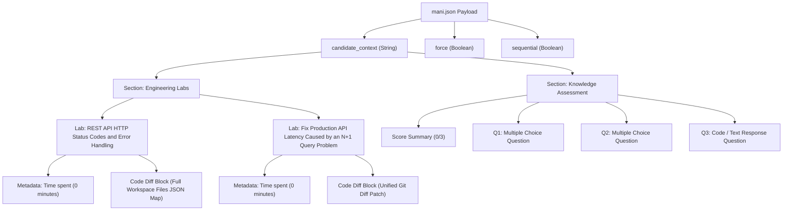
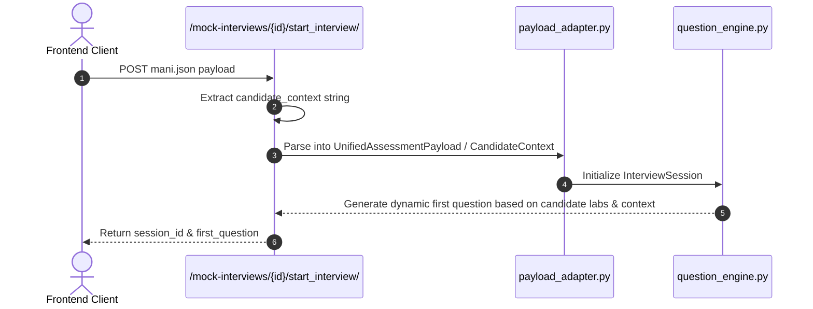

# Payload Dictionary Structure Documentation (`mani.json`)

## Overview

This document provides a detailed specification and architectural breakdown of the interview initialization payload structure observed in [`mani.json`](file:///Users/mkgandhi05/Workspaces/Yuvro/yuvro/mani.json). This payload is transmitted from the frontend ([`VitarkaInterviewScreen.tsx`](file:///Users/mkgandhi05/Workspaces/Yuvro/yuvro/ylabs-web/src/components/discussion/VitarkaInterviewScreen.tsx)) to the backend endpoint (`/mock-interviews/{id}/start_interview/` in [`views.py`](file:///Users/mkgandhi05/Workspaces/Yuvro/yuvro/yhub-backend-api/mockinterviews/views.py)) to initiate an AI-driven interview session with candidate evaluation context.

---

## 1. Top-Level Payload Schema

```json
{
  "candidate_context": "<string>",
  "force": true,
  "sequential": true
}
```

### Field Definitions

| Field | Type | Required | Description |
| :--- | :--- | :--- | :--- |
| `candidate_context` | `string` | Yes | Serialized multi-section markdown text containing the candidate's lab submissions, code snapshots/diffs, and quiz assessment performance. |
| `force` | `boolean` | Optional | When set to `true`, forces initialization of a fresh interview session even if an active session already exists. |
| `sequential` | `boolean` | Optional | Directs the AI question engine to evaluate and progress through questions sequentially. |

---

## 2. Context Structure Diagram



---

## 3. Sub-Component Breakdown of `candidate_context`

### A. Engineering Labs Section (`LAB`)

Constructed dynamically from candidate submissions in [`WorkspaceApp.tsx`](file:///Users/mkgandhi05/Workspaces/Yuvro/yuvro/ylabs-web/src/components/evaluation/WorkspaceApp.tsx).

#### Section Format
```text
Engineering Labs in section '<Section Title>':

--- Lab: <Lab Title> ---
Time spent: <Time in Minutes> minutes
Code Diff:
```diff
<Submission Content>
```
```

#### Submission Types within Code Diff:
1. **Full Workspace File Snapshot (JSON Map)**
   Used when submitting a complete workspace snapshot. Maps relative file paths to their full source code contents:
   ```json
   {
     "config/__init__.py": "",
     "config/asgi.py": "\"\"\"\nASGI config for config project...\n\"\"\"",
     "config/settings.py": "\"\"\"\nDjango settings for config project...\n\"\"\"",
     "config/urls.py": "\"\"\"\nURL configuration...\n\"\"\"",
     "config/wsgi.py": "...",
     "orders/management/commands/seed_data.py": "...",
     "orders/migrations/0001_initial.py": "...",
     "orders/admin.py": "...",
     "orders/apps.py": "...",
     "orders/models.py": "...",
     "orders/serializers.py": "...",
     "orders/urls.py": "...",
     "orders/views.py": "...",
     ".gitignore": "...",
     "README.md": "...",
     "manage.py": "...",
     "requirements.txt": "..."
   }
   ```

2. **Unified Git Diff Patch (`git diff`)**
   Standard unified diff format showing line insertions/deletions:
   ```diff
   diff --git a/orders/views.py b/orders/views.py
   index dcf6c0b..87d6ff9 100644
   --- a/orders/views.py
   +++ b/orders/views.py
   @@ -9,8 +9,3 @@ from .serializers import OrderSerializer
        description="Retrieve all customer orders with associated customer details, products, categories, and calculated totals.",
        responses={200: OrderSerializer(many=True)},
    )
   -class OrderListAPIView(generics.ListAPIView):
   -    queryset = Order.objects.all()
   -    serializer_class = OrderSerializer
   -
   -
   ```

---

### B. Knowledge Assessment Section (`KNOWLEDGE_ASSESSMENT`)

Summarizes performance across multiple-choice or short-answer assessment questions.

#### Section Format
```text
Knowledge Assessment Score: <Score>/<Total>
- Question: <Question Text>
  Selected Answer Option Index: <Index or Selected Content>
  Is Correct: <Yes | No>
```

#### Example in Payload:
```text
Knowledge Assessment Score: 0/3
- Question: Which challenges commonly occur in large-scale sales analysis systems?
  Selected Answer Option Index: 2,1
  Is Correct: No
- Question: Which statements are true regarding advanced SQL sales analysis?
  Selected Answer Option Index: 3,2
  Is Correct: No
- Question: Delete all empty directories inside a given directory.
  Selected Answer Option Index: # Directory Cleanup Tool

Delete all empty directories inside a given directory.

print("mani:")
  Is Correct: No
```

---

## 4. Backend Processing Flow


