# Database Evaluation Architecture

This document provides an end-to-end overview of the database evaluation architecture implemented in the Yuvro Code Executer, focusing on our robust, stateful SQLite implementation and how the system coordinates with the frontend to provide accurate grading. 

## High-Level Architecture Flow

```mermaid
sequenceDiagram
    participant Student as Student (React UI)
    participant API as FastAPI Backend (main.py)
    participant Factory as DatabaseEvaluatorFactory
    participant Evaluator as SQLiteEvaluator
    participant DB as SQLite Database (lab.db)

    Student->>API: POST /database_run (query + scoring_rules)
    API->>Factory: get_evaluator("sqlite")
    Factory-->>API: returns SQLiteEvaluator instance
    API->>Evaluator: execute(body, workspace)
    
    rect rgb(30, 41, 59)
    Note over Evaluator,DB: Execution Phase
    Evaluator->>DB: execute user_query
    DB-->>Evaluator: user_output (or error)
    Evaluator->>DB: execute system_query (if defined)
    DB-->>Evaluator: actual_result
    end
    
    rect rgb(15, 23, 42)
    Note over Evaluator: Evaluation Phase (10 Points)
    Evaluator->>Evaluator: 1. query_matches expected? (25%)
    Evaluator->>Evaluator: 2. system_query output == expected_result? (50%)
    Evaluator->>Evaluator: 3. user_output == expected_output? (25%)
    Evaluator->>Evaluator: Edge Case Check (Stateful Forgiveness)
    Evaluator->>Evaluator: Keyword Check (Prevent unrelated commands)
    end
    
    Evaluator-->>API: EvaluationResult (score_pct, breakdown booleans)
    API-->>Student: JSON Response
    Student->>Student: Renders detailed score breakdown
```



---

## 1. The Factory Approach

To ensure the platform can seamlessly scale to support multiple database engines (SQLite, PostgreSQL, MySQL, MongoDB, etc.) in the future without cluttering the main API logic, we implemented a **Factory Design Pattern**.

### `DatabaseEvaluatorFactory`
Located in `database_evaluator/factory.py`, this factory acts as the single point of entry for database evaluations. 
- The `database_run` API endpoint simply asks the factory for an evaluator based on the requested engine (e.g., `DatabaseEvaluatorFactory.get_evaluator("sqlite")`).
- The factory dynamically instantiates and returns the correct evaluator class (e.g., `SQLiteEvaluator`).
- All evaluators inherit from a `BaseDatabaseEvaluator` interface, ensuring they all expose the same `execute()` and `evaluate()` methods. 

This means if another developer wants to add `PostgreSQL` support tomorrow, they simply create a `PostgreSQLEvaluator` class, register it in the factory, and the API works instantly without any changes to `main.py`.

---

## 2. SQLite Evaluator Implementation (`sqlite.py`)

The `SQLiteEvaluator` class handles the execution and evaluation of SQLite queries in a stateful environment. 

### Execution (`execute`)
- It accepts the user's SQL query and writes it to a temporary `query.sql` file in the user's specific workspace directory.
- It executes the query against the persistent `yuvro.db` file using the `sqlite3` CLI.
- **System State Checks**: If a `system_query` is defined in the sprint payload, the evaluator executes this *second* query immediately after the user's query. This allows us to secretly check the actual state of the database (e.g., did they really create the table? Did they actually delete the row?).

### Stateful Scoring Logic (`evaluate`)
Because SQLite databases are stateful (data persists between "Run" clicks), the grading logic is highly resilient to handle edge cases where a user runs a correct command twice (e.g. running `CREATE TABLE` twice yields a "table already exists" error).

**Scoring Breakdown (Total 10 Points / 1.0 Pct):**
1. **Query Match (2.5 Points / 25%)**: 
   - Checks if the expected SQL syntax (normalized) is present in the user's query.
2. **System Validation (5.0 Points / 50%)**:
   - Compares the output of the hidden `system_query` against the `expected_result`.
   - This is the ultimate source of truth. If the system query passes, it means the database is exactly in the state we wanted.
3. **Output Match (2.5 Points / 25%)**:
   - Checks if the user's console output matches the `expected_output` string or regex.

**Edge Cases & Safeguards:**
- **The "Stateful Forgiveness" Rule**: If the user's query is perfectly written, and the system database is in the perfectly correct state, but the output threw an error (like "table already exists"), the system forgives the output error and awards a perfect `10/10`. This prevents penalizing students for clicking "Run" twice.
- **The "Wrong Command" Penalty**: If the sprint expects a `DELETE` query, but the user writes an `INSERT` query, the system extracts the primary SQL keyword and checks it. If the user uses the wrong command, they receive `0/10` points instantly, preventing them from accidentally earning points off a previously correct database state using unrelated queries.

---

## 3. Sprint Fixtures Injection

To fuel this evaluation engine, the Sprint JSON fixtures (e.g., `sprint_5.json`) include robust validation metadata for every database ticket:
```json
{
  "title": "Delete Old Data",
  "expected_query": "DELETE FROM todos WHERE user_id = 2;",
  "expected_output": "",
  "scoring_rules": {
    "system_query": "SELECT COUNT(*) FROM todos WHERE user_id = 2;",
    "expected_result": "0"
  }
}
```
This metadata is sent in the payload from the frontend to the backend's `database_run` endpoint, dictating exactly how the evaluator should grade the ticket.

---

## 4. Frontend Integration

The React frontend (`student.lab.$slug.ticket.$ticketId.tsx`) maps this rich evaluation data directly to the user interface.

### Payload Transmission
When the student clicks "Run", the frontend maps the `scoring_rules` and `solution` objects from the current ticket state and injects them into the POST payload alongside the user's query.

### Score Rendering
When the backend responds, the frontend parses the `evaluation` object to render a highly transparent breakdown of the student's score in the terminal console:
- If `res.evaluation.query_matches` is true: `+2.5`
- If `res.evaluation.output_matches` is true: `+2.5`
- If `res.evaluation.system_matches` is true: `+5.0`

Because the backend explicitly returns the boolean states of `query_matches`, `output_matches`, and `system_matches`, the frontend's visual breakdown is guaranteed to mathematically match the `Total Points` awarded, eliminating any user confusion about why they lost points.

---

## 5. Scaling to Other Database Engines

The architecture we've built for SQLite translates perfectly to any other database engine.

If you want to add **PostgreSQL**:
1. **Create `postgres.py`**: Inherit from `BaseDatabaseEvaluator`.
2. **Execute**: Override `execute()` to use `psql` (or an async python postgres driver) instead of `sqlite3`, connecting to a spun-up Postgres container or URL.
3. **Evaluate**: Inherit the exact same 3-step `evaluate()` logic (Query Match, System Validation, Output Match). The stateful forgiveness rules and keyword penalties apply universally to SQL!
4. **Register**: Add it to `DatabaseEvaluatorFactory`.
5. **JSON Fixtures**: Set `"database_engine": "postgres"` in the JSON payload.

The frontend and the main API endpoints will require zero changes to support it.
