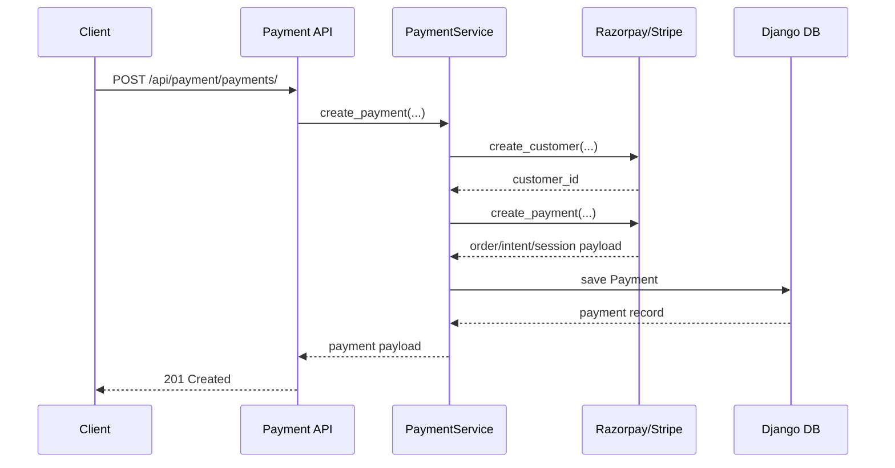
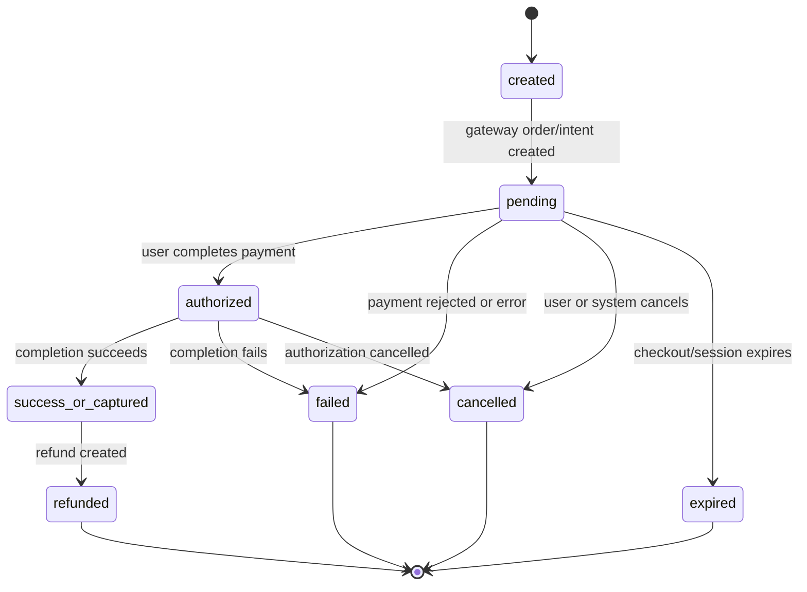

# Payment Flow

## Overview

This payment module supports creating a payment record, creating a gateway customer, creating a gateway checkout/order intent, capturing or cancelling a payment, and creating refunds.

## Flow

1. Client calls the payment API.
2. The backend creates a local payment record.
3. The backend creates or resolves a gateway customer reference.
4. The backend creates a gateway order/intent/session.
5. The frontend uses the gateway response to continue checkout.
6. Webhooks or explicit capture/cancel/refund actions update the payment state.

## Sequence Diagram

## Payment Status Lifecycle

The payment status represents the current state of the payment in our system and the gateway flow.

### Status overview

- `created`: payment record exists, but the gateway flow has not started or completed yet.
- `pending`: the payment has been created at the gateway and is waiting for user completion or gateway confirmation.
- `authorized`: the payment has been authorized by the gateway, but it has not yet been captured.
- `success_or_captured`: the payment was successfully completed and funds are considered settled for the merchant flow.
- `failed`: the payment attempt failed due to an error, rejection, or invalid payment method.
- `cancelled`: the payment or authorization was cancelled before completion.
- `expired`: the payment session or authorization expired before completion.
- `refunded`: the payment was refunded completely or partially through the gateway.

### Status flow diagram

### Meaning of each status

- `created` is the first state after creating the local payment record.
- `pending` means the payment is in progress at the gateway.
- `authorized` means the gateway approved the payment but capture has not happened yet.
- `success_or_captured` means the payment was successfully completed and the transaction is complete for the merchant flow.
- `failed` means the payment could not be completed.
- `cancelled` means the user or system intentionally stopped the flow.
- `expired` means the payment session or authorization expired before it could be completed.
- `refunded` means the payment was reversed after successful capture.

## Notes

- The module currently uses HTTP-based gateway integration rather than SDK libraries.
- Refunds are stored as separate records in the `Refund` model.
- The gateway-specific payloads are handled through the gateway factory and gateway implementations.
